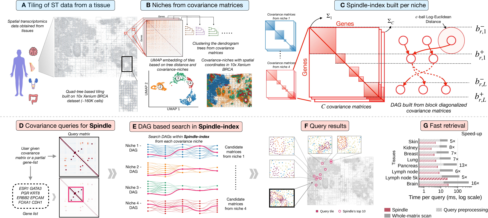

# Spindle (development repository)

**Scalable indexing of spatial-omics data for fast querying.**

This is the development repository: the package is `spindle_dev` and the dataset paths are those of our cluster. The
public release, with the same method and results, is
[sarkar-lab/spindle](https://github.com/sarkar-lab/spindle).

Spindle searches spatial transcriptomics data by gene co-expression. Each tissue section is cut into tiles, and each
tile is summarized by its gene–gene covariance matrix. Given a query, Spindle finds the tiles whose genes co-vary most
like it, measured by the log-Euclidean distance between covariance matrices.



*Overview of Spindle. **A** A Xenium section is tiled by a quadtree. **B** Tiles are grouped into covariance niches.
**C** Within each niche, the covariance matrices are approximately block diagonal in a shared gene order, and a
layered DAG stores the shared block logarithms. **D** A query is a covariance matrix or a gene list. **E** The DAGs
are searched within a distance budget. **F** A query tile and the 10 tiles Spindle returns. **G** Time per query on
one core.*

## What it does

Spindle exploits the approximate block-diagonal structure of gene–gene covariance matrices. It groups tiles into
covariance niches and finds, for each niche, a gene order in which the matrices are close to block diagonal. The
logarithms of the blocks, not of whole matrices, are stored and shared across tiles, in one layered directed acyclic
graph (DAG) per niche. A distance-budgeted depth-first search prunes paths whose lower bounds exceed the budget.

It answers three kinds of query:

- **Complete query:** a tile's covariance matrix over all genes.
- **Partial query:** a covariance matrix over a subset of genes, searched without filling in the missing entries.
- **Gene-list query:** a list of genes alone, turned into a template covariance matrix.

Two indexes answer them:

- **Spindle** (`Spindle`, `SpindlePartial`): the compact index with the DAG search.
- **Spindle-naive** (`SpindleNaive`, `SpindleNaivePartial`): an exact scan that stores every tile's block logarithms
  and ranks all tiles by the same block distance. It is the reference that Spindle is measured against.

On eight 10x Xenium datasets (87,000–817,000 cells), Spindle indexes are 113–197 times smaller than the whole
covariance matrices. A complete query, including query preprocessing, takes 2.8–28 ms on one CPU core, 5.1–16 times
faster than a scan over the whole matrices. The returned tiles recover a median of 81% of the exact near neighbors.

## Installation

Spindle needs Python 3.9 or later on Linux (x86-64 with AVX2), and gcc the first time it runs, to compile its C
search kernels. Create and activate a virtual environment, then install the dependencies and the package:

```bash
git clone https://github.com/sarkar-lab/spindle_dev.git
cd spindle_dev
python -m venv .venv
source .venv/bin/activate
python -m pip install --upgrade pip
pip install -r requirements.txt
pip install -e .
```

## Quickstart

Build the layout and the indexes from one section (an `.h5ad` file with raw counts in `X` and cell centroids in
`obsm["spatial"]`). Here 10% of the tiles are held out to use as queries:

```python
import spindle_dev as sd

adata = sd.load_adata("section.h5ad")
tiles, covs, genes = sd.prepare_tiles(adata, max_genes=800)
train, test = sd.split_tiles(len(tiles), seed=0, test_ratio=0.1)
train_covs = [covs[i] for i in train]
data = sd.build_layout([tiles[i] for i in train], train_covs, genes, adata.n_obs)
```

**Complete query**, a held-out tile's whole covariance matrix:

```python
naive = sd.SpindleNaive(data, train_covs)
spindle = sd.Spindle.from_naive(naive, data)
query = covs[test[0]]
rows, scores, seconds = naive.search(query, c=10)   # exact top 10 by the block distance d_B
rows, scores, seconds = spindle.search(query)       # Spindle's tiles, best first (budget g = 0.25)
```

**Partial query**, the same tile's covariance restricted to a gene set:

```python
naive_partial = sd.SpindleNaivePartial(data, train_covs)
spindle_partial = sd.SpindlePartial.from_naive_partial(naive_partial, data)
idx, found, missing = sd.gene_indices(genes, ["CD68", "CD163", "CD14", "AIF1", "MNDA"])
cov_s, idx = sd.tile_query(query, idx)
rows, scores, seconds = naive_partial.search(cov_s, idx, c=10)   # exact top 10 by d_B^S
rows, scores, seconds = spindle_partial.search(cov_s, idx)       # budget g = 1
```

**Gene-list query**, from gene names alone:

```python
omega = sd.variance_quantiles(train_covs)           # keep it beside the index
cov_s, idx = sd.template_query(omega, idx)          # correlation 0.5, 90th-percentile variances
rows, scores, seconds = spindle_partial.search(cov_s, idx)
```

`rows` are positions among the index tiles (`train[rows]` gives tile numbers). A query covariance built elsewhere must
be shrunk first (`spindle_dev.metrics.shrink_cov`), as the index tiles are. `sd.save_index` and `sd.load_index` save and
load an index or a layout.

[`examples/spindle_quickstart.ipynb`](examples/spindle_quickstart.ipynb) runs all of the above in a notebook and maps
what each query returns (set `DATASET` in its first cell). `python examples/run_single_dataset.py <key | file.h5ad>`
does the same from the command line and reports Spindle's accuracy against Spindle-naive.

## Reproducing the paper

### Data

The paper uses public 10x Genomics datasets. Download them, convert each to an `.h5ad` file with raw counts in `X` and
cell centroids in `obsm["spatial"]`, and point the `dirs` entries of [`datasets.yaml`](datasets.yaml) at your copies
(they point at our cluster's copies).

| Key in `datasets.yaml` | Dataset |
|---|---|
| `skin_melanoma` | [Human skin preview data (Xenium human skin gene expression panel add-on)](https://www.10xgenomics.com/datasets/human-skin-preview-data-xenium-human-skin-gene-expression-panel-add-on-1-standard) |
| `kidney_nondiseased` | [Human kidney preview data (Xenium human multi-tissue and cancer panel)](https://www.10xgenomics.com/datasets/human-kidney-preview-data-xenium-human-multi-tissue-and-cancer-panel-1-standard) |
| `breast_cancer` | [Preview data: FFPE human breast cancer with Xenium in situ gene expression](https://www.10xgenomics.com/products/xenium-in-situ/preview-dataset-human-breast) |
| `lung_cancer` | [Preview data: FFPE human lung cancer with Xenium multimodal cell segmentation](https://www.10xgenomics.com/datasets/preview-data-ffpe-human-lung-cancer-with-xenium-multimodal-cell-segmentation-1-standard) |
| `pancreatic_cancer` | [Pancreatic cancer with Xenium human multi-tissue and cancer panel](https://www.10xgenomics.com/datasets/pancreatic-cancer-with-xenium-human-multi-tissue-and-cancer-panel-1-standard) |
| `lymph_node` | [Human lymph node preview data (Xenium human multi-tissue and cancer panel)](https://www.10xgenomics.com/datasets/human-lymph-node-preview-data-xenium-human-multi-tissue-and-cancer-panel-1-standard) |
| `lymph_node_5k` | [Preview data: FFPE human lymph node with 5K pan tissue and pathways panel](https://www.10xgenomics.com/datasets/preview-data-xenium-prime-gene-expression) |
| `brain_cancer` | [FFPE human brain cancer data with human immuno-oncology profiling panel and custom add-on](https://www.10xgenomics.com/datasets/ffpe-human-brain-cancer-data-with-human-immuno-oncology-profiling-panel-and-custom-add-on-1-standard) |
| `tonsil_reactive` | [Human tonsil data with Xenium human multi-tissue and cancer panel](https://www.10xgenomics.com/datasets/human-tonsil-data-xenium-human-multi-tissue-and-cancer-panel-1-standard) (cell-count scaling only) |
| `cross_modal_xenium`, `cross_modal_visium` | Serial Xenium and Visium sections of one breast tumor ([Janesick et al., 2023](https://doi.org/10.1038/s41467-023-43458-x)), registered to common coordinates with SIID |

### Steps

The experiments also need `pandas`, `matplotlib`, `threadpoolctl` and `jupyter_client`, with the environment
registered as the Jupyter kernel `spindle_env`. Build the search kernels once before running anything on nodes without
a C compiler: `python -c "import spindle_dev.kernels as k; k.build()"`.

1. **Index cache** ([`R0_index_cache`](experiments/compute/R0_index_cache.ipynb)) builds all indexes and stages their
   inputs in `results/_cache/`. By default it uses the low-memory build, which runs in 16 GB but keeps intermediate
   matrices on disk, so its speed depends on the disk's read speed. The paper reports the in-memory builds
   (`LOWMEM = False`; about 55 GB for brain cancer).
2. **Results** ([`experiments/compute/`](experiments/compute/), R1–R12): each notebook writes its results as CSV files
   to `results/<topic>/`.
3. **Figures and tables** ([`experiments/figures/`](experiments/figures/)): each notebook draws one figure into
   `figures/<figure>/`; `T_supplement` writes the supplementary tables.

| Paper | Notebook | Figure | Inputs |
|---|---|---|---|
| Fig 1F, G (query results, fast retrieval) | [`F1_overview_f`](experiments/figures/F1_overview_f.ipynb) | panels only | R0, R2, R4 |
| Fig 2 (storage, time, accuracy) | [`F2_cost`](experiments/figures/F2_cost.ipynb) | [`fig2_cost`](figures/fig2_cost/) | R1, R2, R3, R4 |
| Fig 3 (cross-platform and within-platform queries) | [`F3_cross_platform`](experiments/figures/F3_cross_platform.ipynb) | [`fig3_cross_platform`](figures/fig3_cross_platform/) | R5, R6 |
| Fig 4 (partial and gene-list queries) | [`F4_skin`](experiments/figures/F4_skin.ipynb) | [`fig4_skin`](figures/fig4_skin/) | R7, R8, R9 |
| Supp. Fig S1 (block structure) | [`S1_block`](experiments/figures/S1_block.ipynb) | [`figS1_block`](figures/figS1_block/) | R10 |
| Supp. Fig S2 (block distance vs whole-matrix distance) | [`S9_block_distance`](experiments/figures/S9_block_distance.ipynb) | [`figS9_block_distance`](figures/figS9_block_distance/) | R12 |
| Supp. Fig S3 (breast niches and gene blocks) | [`S2_breast`](experiments/figures/S2_breast.ipynb) | [`figS2_breast`](figures/figS2_breast/) | R6 |
| Supp. Fig S4 (index cost vs cells and genes) | [`S3_scaling`](experiments/figures/S3_scaling.ipynb) | [`figS3_scaling`](figures/figS3_scaling/) | R1 |
| Supp. Fig S5 (query time on several cores) | [`S8_parallel`](experiments/figures/S8_parallel.ipynb) | [`figS8_parallel`](figures/figS8_parallel/) | R11 |
| Supp. Fig S6 (retrieval accuracy) | [`S4_accuracy`](experiments/figures/S4_accuracy.ipynb) | [`figS4_accuracy`](figures/figS4_accuracy/) | R2, R3 |
| Supp. Fig S7 (platform shift and tissue agreement) | [`S5_cross_platform`](experiments/figures/S5_cross_platform.ipynb) | [`figS5_cross_platform`](figures/figS5_cross_platform/) | R5 |
| Supp. Fig S8 (dendrograms, consensus tree, blocks) | [`S6_blocks`](experiments/figures/S6_blocks.ipynb) | [`figS6_blocks`](figures/figS6_blocks/) | R10 |
| Supp. Fig S9 (dyadic decomposition) | [`S7_dyadic`](experiments/figures/S7_dyadic.ipynb) | [`figS7_dyadic`](figures/figS7_dyadic/) | R10 |
| Supp. Tables S1–S7 | [`T_supplement`](experiments/figures/T_supplement.ipynb) | [`supp_tables`](figures/supp_tables/) | R1, R4, R7, R8, R9 |

Fig 1 as published is in [`figures/fig1_overview/`](figures/fig1_overview/); panels A–E were drawn by hand.
`T1`–`T7.tex` are Supp. Tables S1–S4, S6, S7 and S5, in that order.

`examples/check_indexes.py <key>` (through sbatch on large sections) checks one dataset's indexes: exact self-queries,
compiled searches equal to their references bit for bit, and the lower bound and safety of both Spindle indexes.

## Repository layout

```
src/spindle_dev/              the package
  preprocessing.py              tiling, gene selection, shrunk tile covariances, train / held-out split
  layout.py                     covariance niches, gene order and blocks per niche (shared by all indexes)
  spindle.py                    Spindle, complete queries
  spindle_partial.py            Spindle, partial queries (SpindlePartial)
  naive.py                      Spindle-naive (SpindleNaive, SpindleNaivePartial)
  queries.py                    partial queries from gene names (gene_indices, template_query, tile_query)
  kernels.c, kernels.py         compiled searches
  metrics.py, utils.py          shrinkage, matrix logarithms; save / load
examples/                     quickstart notebook, single-dataset run, index checks
experiments/
  common/                       shared modules and Slurm scripts
  compute/                      R0–R12: result notebooks, writing to results/
  figures/                      figure and table notebooks, writing to figures/
results/<topic>/              CSV / NPZ inputs of the figures, with a manifest.json per topic
figures/<figure>/             each figure in the paper (PDF + PNG); supp_tables/ holds the LaTeX tables
datasets.yaml, paths.py       dataset locations (the only place a path is written) and their reader
```

## License

Spindle is released under the [GNU General Public License v3.0](LICENSE).
